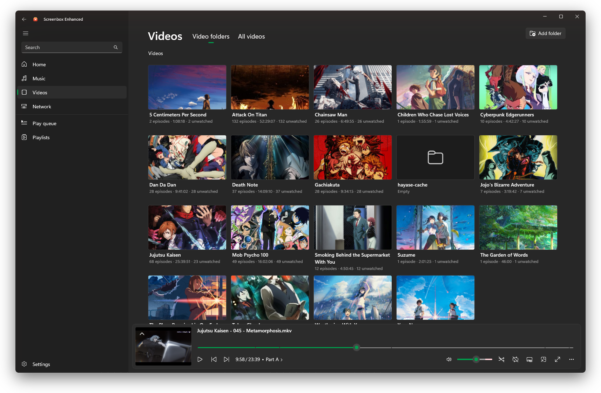
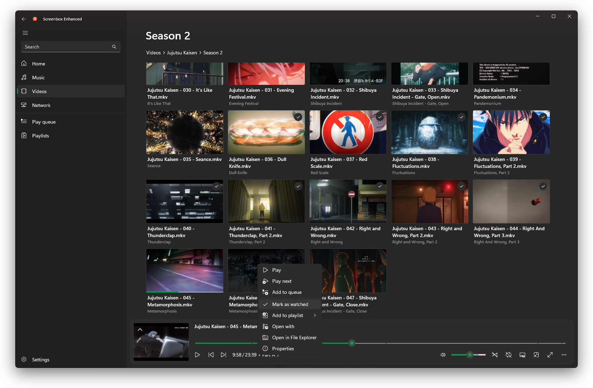
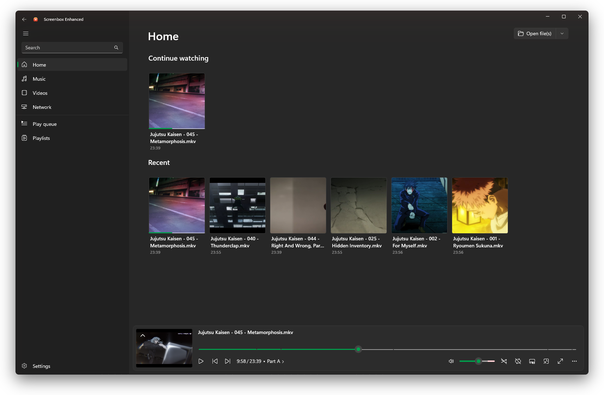
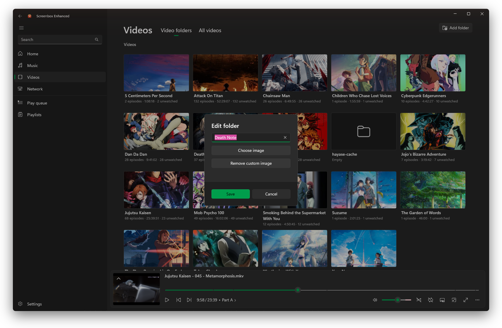
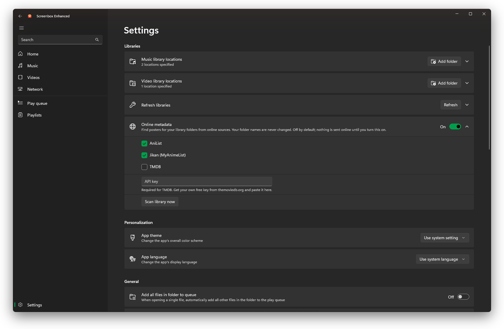

  

<h1 align="center">
  Screenbox Enhanced
</h1>

  A personal media centre for Windows, built on Screenbox

Screenbox Enhanced is a fork of [Screenbox](https://github.com/huynhsontung/Screenbox), the modern media player by [Tung Huynh](https://github.com/huynhsontung). Everything that makes Screenbox a fast, friendly player is still here. This fork adds a library layer on top, for people who keep a collection of series and films on their own drives.

Screenbox is licensed under GPL-3.0, and so is this fork. Credit for the player belongs to the original project. If you just want a great player, [get Screenbox from the Microsoft Store](https://www.microsoft.com/store/apps/9NTSNMSVCB5L).

<picture>
  <source media="(prefers-color-scheme: dark)" srcset="/assets/images/docs/PC-HeroVideosPage-Dark.png?raw=true">
  <source media="(prefers-color-scheme: light)" srcset="/assets/images/docs/PC-HeroVideosPage-Light.png?raw=true">
  
</picture>

## What this fork adds

### A library that knows your series

Every folder shows how many episodes it holds, their total runtime and how many you haven't watched yet. Episode numbers and titles are read from file names, so a season reads as an ordered list rather than a pile of files.

Artwork comes from a `poster.jpg` or `folder.jpg` in the folder, an image you pick yourself, or a frame from the first episode. With [online metadata](#optional-online-posters) switched on, it can also come from AniList, Jikan or TMDB.

### Watched tracking

Episodes are marked watched as you finish them, and partly watched ones show how far you got. Right-click any episode to mark it watched or unwatched yourself, for something you watched elsewhere or skipped through.

### Continue Watching

Home picks up where you left off, with a Continue Watching row above your recent media.

### Make each folder your own

Give any folder a display name and poster of your choosing, and remove a custom poster to go back to automatic artwork. Your choices always take priority over anything found online.

### Optional online posters

Turn on online metadata in Settings to fetch posters from AniList, Jikan (an unofficial MyAnimeList API) and TMDB, using your own TMDB key. It is off by default and sends nothing until you switch it on. Only a cleaned-up folder name is sent, and your folder names are never changed. See the [privacy policy](PRIVACY.md).

## Everything from Screenbox

- Fluent design user interface
- Gesture support for seeking and changing volume
- Window resize hotkeys (number row `1`-`4`)
- YouTube-inspired hotkey layout
- Picture-in-picture mode
- Save the video frame as an image
- Chromecast support
- Browse and play media over the network

## Install

Screenbox Enhanced is not on the Microsoft Store. Build it from source as described below. A sideload package is also attached to each run of the repository's build workflow.

## Contribute

Feel free to open an issue if you want to report a bug, give feedback, or ask a question. PRs are very welcome!

### For Contributors

- 📖 **[Contributing Guide](CONTRIBUTING.md)** - Complete guide for new contributors
- 🏗️ **[Project Structure](docs/PROJECT_STRUCTURE.md)** - Detailed codebase architecture overview

### Quick Start for Developers

1. **Prerequisites**: Visual Studio 2026 with UWP development workload
2. **Clone**: `git clone https://github.com/KayTwoOne/ScreenboxEnhanced.git`
3. **Build**: Open `Screenbox.slnx` and build the solution (Ctrl+Shift+B)
4. **Run**: Set platform to x64 and start debugging (F5)

See the [Contributing Guide](CONTRIBUTING.md) for detailed setup instructions.

## Translation

Translations come from the original Screenbox project. Help translate it on [Crowdin](https://crowdin.com/project/screenbox)! Crowdin offers an intuitive UX for you to get started and is the recommended tool for localization. Translations are automatically synced to GitHub and published in the next minor update.

You can also translate the app locally without Crowdin. The project source language is English, United States. All localizable source files are in the `Screenbox\Strings\en-US` directory. Localizable file types are `.resw` and `.md`.

Make sure you have your translations in the appropriate folder under the `Screenbox\Strings` directory. We use a [IETF language tag](https://www.venea.net/web/culture_code) to name the folder that contains resources for that language (e.g. `fr-FR` for French (France), `es-ES` for Spanish (Spain)). Files in these folders are translated copies of the original resource files in `Screenbox\Strings\en-US`.

A typical workflow for translating resources:

1. Fork and clone this repo.
1. Create a folder for your language under `Screenbox\Strings` if there isn't one already.
1. Copy over any missing files from the `en-US` folder. 
1. Translate the `.resw` and `.md` files in the directory.
1. Once you're done, commit your changes, push to GitHub, and make a pull request.
